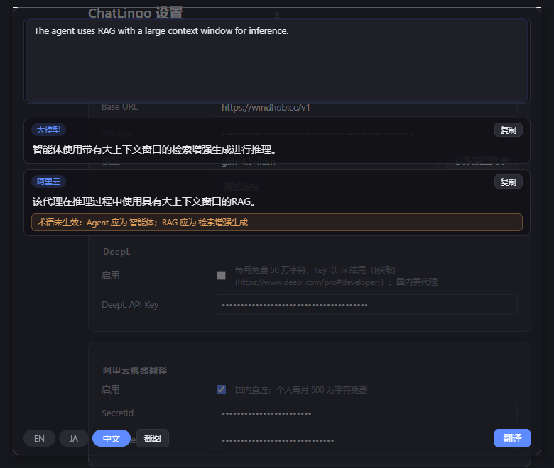
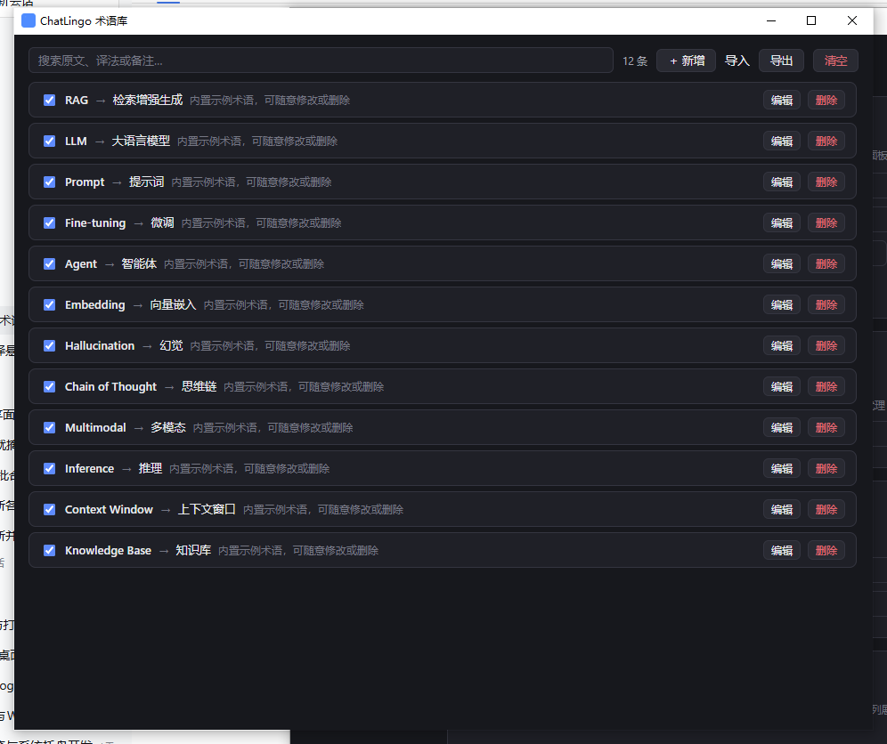

# ChatLingo

> AI 对话双语悬浮翻译器 —— 你用中文打字，Agent 看到英文；Agent 用英文回复，你读到中文。

> 为了纯英文使用 ChatGPT 而生。

[](docs/03-开发计划.md)   

## 这是什么

**ChatLingo 把「翻译提问 → 粘贴 → 翻译回复 → 粘贴」这个循环压缩到一次快捷键。** 它是一个常驻系统托盘的桌面小工具：

- 按 <kbd>Alt</kbd>+<kbd>T</kbd>，光标处呼出统一翻译面板：输入中文（或截图识别文字），选好目标语言回车，流式译文出来后**自动粘贴回你原来的输入框**——ChatGPT 收到的就是地道英文；
- 复制 Agent 的英文回复，屏幕角落自动弹出**半透明中文对照面板**，Markdown 排版和代码块原样保留——你读到的就是地道中文。

从「想到一句话」到「这句话以英文出现在 ChatGPT 输入框」，全程不超过 2 次按键。纯英文对话的质量收益，零表达成本拿到。

## 界面一览

**Alt+T 统一面板**（多引擎并行 + 术语强制 + 译后校验提示）：



> 同一句子双引擎并行：大模型严格按术语表译出「智能体 / 检索增强生成」；阿里云保留 RAG 原样时，
> 卡片下方自动出现橙色「术语未生效」提示行（不强行改写，交给人类判断）。

**术语库管理**（托盘「术语库…」打开）：



## 核心特性

| 特性 | 说明 |
| --- | --- |
| **统一入口** | `Alt+T` 一个面板搞定一切：选目标语言、文本输入、截图识别，面板内任意位置回车触发 |
| **三引擎自由组合** | 大模型（任意 OpenAI 兼容 API）/ DeepL / 阿里云机器翻译，各自独立开关，开谁用谁 |
| **多引擎并行对比** | 开启多个引擎时同时翻译，结果并列展示（Alt+T 面板堆叠卡片、阅读面板多栏），各带独立复制按钮 |
| **术语库** | 维护「原文 → 固定译法」术语表，翻译时自动注入所有引擎：大模型 Prompt 强制注入、DeepL 官方 Glossary API、阿里云 Context 上下文；传统引擎译文未按术语翻译时追加橙色提示行（不强行替换）。搜索/启停/冲突标黄/JSON·CSV 导入导出，增删即生效 |
| **语种智能联动** | 设置页语言列表 = 启用渠道支持语言的并集，随开关实时变化；运行时自动跳过不支持当前目标语言的引擎 |
| **截图翻译** | 框选屏幕任意区域（图片、视频、不可复制界面均可），视觉模型识别文字回填输入框，校对后再翻译 |
| **格式保真** | 大模型翻译保留 Markdown 结构，代码块、行内代码、URL 原样跳过不译 |
| **自由面板** | 拖动（位置记忆+屏幕内钳制）、边缘缩放、输入/输出分界线拖拽调比例；半透明毛玻璃，控件实底 |
| **智能跳过 + 缓存** | 已是目标语言不翻、代码主导跳过、短文本忽略；相同内容命中本地缓存秒出、并发请求自动合并 |
| **剪贴板监听** | 复制外文文本自动弹译文面板（可关闭、可调阈值），零按键阅读通道 |
| **翻译历史** | 本地 SQLite 存储，可搜索、一键复制、清空，标注实际使用引擎 |
| **数据自主** | 数据目录自定义（一键迁移）+ 便携模式（exe 旁 `chatlingo.portable` 标记即启用） |
| **本地优先** | 配置与密钥只存本机，无遥测、无账号、无云端依赖；托盘常驻、单实例、开机自启可选 |

## 安装

从 [Releases](https://github.com/rem-sy/chatlingo/releases) 下载最新版：

1. `ChatLingo_0.4.x_x64-setup.exe` 双击安装（装到用户目录，无需管理员权限），开始菜单启动
2. 托盘图标右键 → **设置**，启用并配置至少一个引擎（见下文），点「测试连接」
3. <kbd>Alt</kbd>+<kbd>T</kbd> 开始使用

> 绿色版：Release 里的 `chatlingo.exe` 可直接运行，但**必须放在纯英文路径**（见 [已知问题](#已知问题)）。在 exe 同目录创建名为 `chatlingo.portable` 的空文件即进入便携模式，数据存于 exe 旁 `data/` 子目录。
>
> 数据位置（配置/翻译历史）默认在 `%APPDATA%\com.remsy.chatlingo\`，设置页「数据目录」可自定义任意位置并一键迁移。

## 使用说明

### 唯一入口：Alt+T 统一翻译面板

按 <kbd>Alt</kbd>+<kbd>T</kbd> 在光标处呼出悬浮翻译面板，一个入口搞定所有翻译：

- **选目标语言**：语言胶囊点击切换（可用语言在设置页勾选配置）
- **文本输入**：打字或粘贴，<kbd>Enter</kbd> 翻译（焦点在面板内任意位置均可），译文流式显示；目标为外语时可选「粘贴回填」（自动模拟 <kbd>Ctrl</kbd>+<kbd>V</kbd> 贴回原输入框）
- **截图输入**：点「截图」→ 框选屏幕任意区域 → 识别出的文字**回填输入框，可先校对再翻译**
- **多引擎结果**：开启多个引擎时，各引擎译文以带标签的卡片堆叠展示，各自带复制按钮
- **布局调整**：拖动顶部把手或底部工具栏空白处移动面板（位置记忆）；拖动边缘缩放；拖动输入/输出之间的分界线调整比例
- <kbd>Esc</kbd> 收起，<kbd>Shift</kbd>+<kbd>Enter</kbd> 换行

另外一条零按键通道：**剪贴板自动监听**（设置页可开关）——复制任意外文文本（≥最小长度、非代码主导），右下角自动弹出对照面板。多引擎时该面板以多栏并列展示各引擎结果，「原文」可折叠对照。

### 术语库：让专有名词永远翻译一致

托盘「术语库…」或设置页入口打开管理窗口。添加如 `RAG → 检索增强生成`、`Agent → 智能体`，翻译时自动生效：

- **大模型**：命中的术语以「必须严格遵守」的术语表注入 system prompt
- **DeepL**：自动创建官方 Glossary 资源并在翻译时引用（语言对受限，不支持时自动降级）
- **阿里云**：术语拼接为 Context 上下文（软约束）
- **译后校验兜底**：传统引擎译文未按术语翻译时，结果卡片追加橙色「术语未生效」提示行，不强行替换避免破坏语法
- 同原文多条不同译法自动标黄；JSON / CSV 导入导出；增删改即时生效，无需重启

### 引擎配置

三个引擎各自独立开关，**开谁用谁**：只开一个就只用这一个；开多个则并行翻译对比；全关则提示未启用。

| 引擎 | 接入 | 免费额度 | 网络要求 |
| --- | --- | --- | --- |
| 大模型（OpenAI 兼容） | Base URL + API Key + 模型（支持一键获取渠道模型列表下拉选择） | 按平台 | 视渠道 |
| [DeepL](https://www.deepl.com/pro#developer) | API Key（免费版以 `:fx` 结尾） | 每月 50 万字符 | 国内需代理 |
| 阿里云机器翻译 | AccessKeyId + AccessKey Secret（[控制台](https://mt.console.aliyun.com)开通） | 个人每月 100 万字符 | 国内直连 |

**视觉模型（截图 OCR）**：需支持图片输入（如 gemma-4、grok 系列），同样支持从渠道拉取列表选择。

**语言配置**：设置页「可用语言」网格只显示**启用渠道支持语言的并集**，随引擎开关实时变化；源语言全引擎自动识别，无需选择。

| 语言 | 大模型 | DeepL | 阿里云 |
| --- | --- | --- | --- |
| 英/日/韩/中/法/德/西/俄/葡/意 | ✓ | ✓ | ✓ |
| 印尼语 | ✓ | ✓ | — |
| 泰/越/阿拉伯 | ✓ | — | ✓ |
| 印地语 | ✓ | — | — |

### 快捷键

| 快捷键 | 作用 | 可自定义 |
| --- | --- | --- |
| <kbd>Alt</kbd>+<kbd>T</kbd> | 呼出/收起统一翻译面板（文本输入/截图/选方向） | ✓ 设置页（点击录入式配置） |

### 托盘菜单

呼出翻译面板 · 术语库 · 翻译历史 · 设置 · 退出（退出请走托盘，避免托盘图标残留）

## 已知问题

- **注意：exe 不能放在含中文等非 ASCII 字符的路径下运行**：WebView2 的限制，创建窗口会报 `os error 5` 闪退。安装版无此问题（固定装在英文路径）；本仓库已通过 `src-tauri/.cargo/config.toml` 将构建目录固定到 `C:/chatlingo-target` 规避。
- Windows 托盘偶现幽灵图标：进程被任务管理器强杀后的残影，鼠标悬停即消失，不影响功能。
- 模拟 <kbd>Ctrl</kbd>+<kbd>V</kbd> 回填在个别屏蔽模拟输入的应用（如部分游戏、管理员权限窗口）中无效，此时退化为「仅复制」，手动粘贴即可。

## 开发

```bash
npm install
npm run tauri dev    # 开发调试
npm run tauri build  # 出安装包（C:\chatlingo-target\release\...）
```

**技术栈**：Tauri 2（Rust 核心，业务全部在 Rust 侧）+ Vue 3 + TypeScript + Vite。

**架构**：六窗口（`quickbar` / `panel` / `settings` / `history` / `glossary` / `snip`）+ 事件驱动。Rust 侧：`capture`（快捷键/剪贴板监听）→ `detect`（脚本统计语言检测）→ `engines`（`TranslationEngine` trait：OpenAI 兼容流式 / DeepL / 阿里云，含语种支持过滤与术语注入）→ `actions`（写剪贴板/模拟粘贴）+ `store`（SQLite 历史 + 术语库）。前端零业务逻辑。

```
docs/
├── 00-开源参考调研.md   # pot/CopyTranslator/nextai-translator 等同类项目分析与差异化定位
├── 01-设计理念.md       # 方向感知、无感优先、格式保真、本地优先
├── 02-设计方案.md       # 交互形式、翻译流水线、技术架构、竞品对比
├── 03-开发计划.md       # 里程碑与任务清单
├── design/              # 实现级设计（GLOSSARY_DESIGN 等）
└── prompts/             # 各里程碑开工提示词
```

## Roadmap

- [x] M1 输入方向（统一面板 + 流式翻译 + 自动回填）
- [x] M2 输出方向（剪贴板监听 + 对照面板）
- [x] M3a 引擎生态·上（DeepL + 连接测试 + 译文缓存与请求合并）
- [x] M3b 引擎生态·下（多引擎并行对比、截图翻译 OCR）
- [x] M4 打磨·上（翻译历史 SQLite、开机自启、数据目录/便携模式、引擎开关式重构、语种联动、UI 重铸）
- [x] M5 术语库（Prompt 注入 + DeepL Glossary API + 阿里云 Context + 译后校验 + 管理窗口）
- [ ] M6 打磨·下（自动更新、macOS/Linux 适配）
- [ ] 远期：按应用记忆方向偏好、双语对话侧栏

## License

MIT © [rem-sy](https://github.com/rem-sy)
